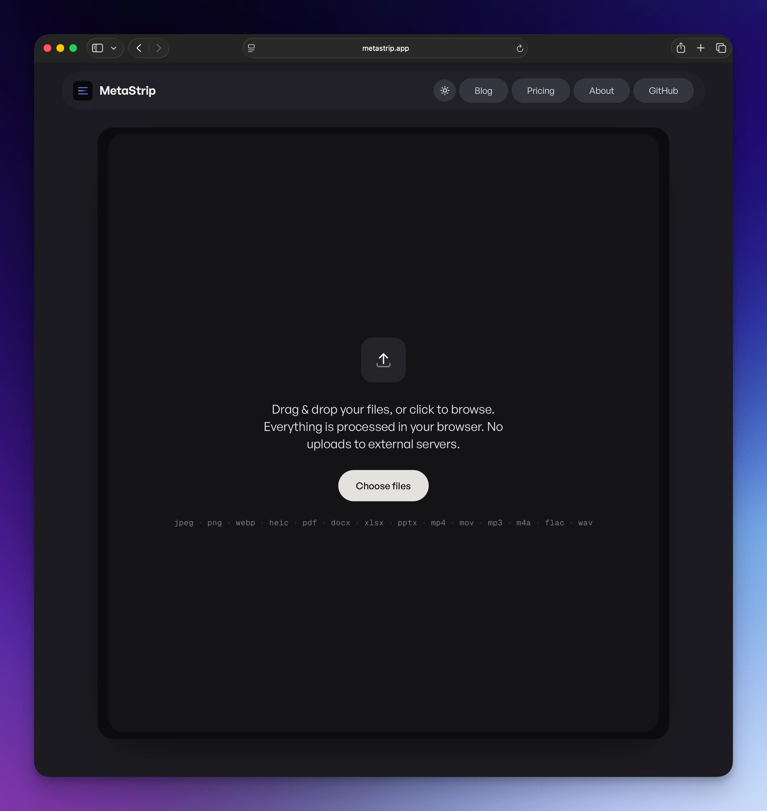
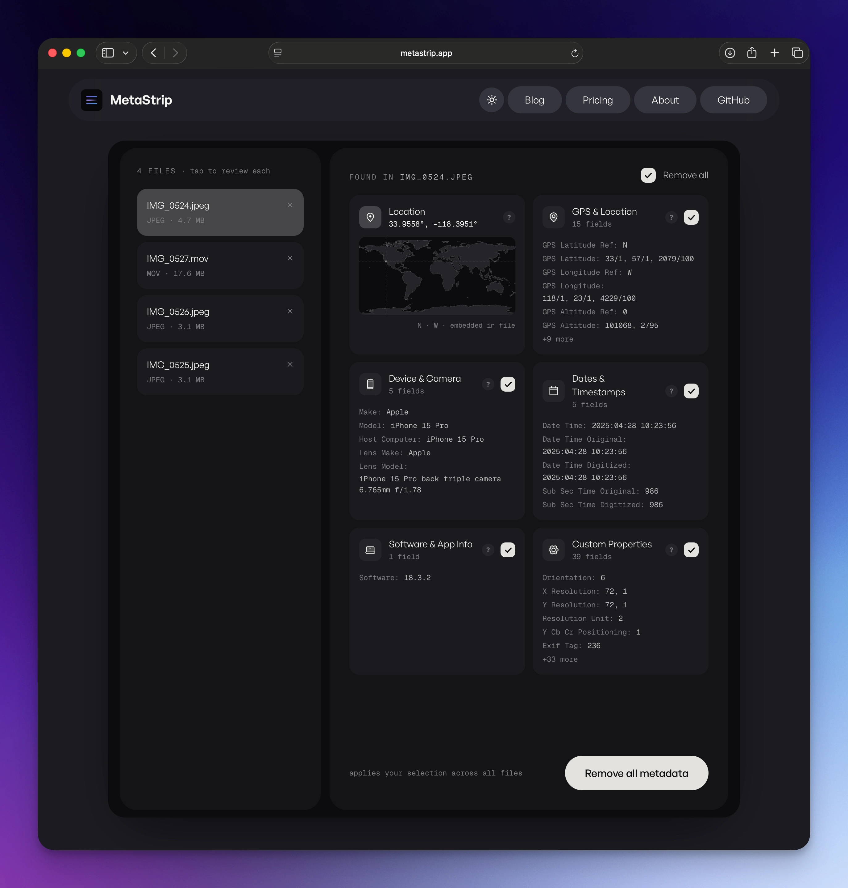

```
___  ___     _        _____ _        _       
|  \/  |    | |      /  ___| |      (_)      
| .  . | ___| |_ __ _\ `--.| |_ _ __ _ _ __  
| |\/| |/ _ \ __/ _` |`--. \ __| '__| | '_ \ 
| |  | |  __/ || (_| /\__/ / |_| |  | | |_) |
\_|  |_/\___|\__\__,_\____/ \__|_|  |_| .__/ 
                                      | |    
                                      |_|    
```

# MetaStrip

**Strip hidden metadata, including C2PA Content Credentials and AI-generation markers, from photos, PDFs, Office documents, video, and audio, entirely in your browser.**

[metastrip.app](https://metastrip.app) · [@larsitodev](https://x.com/larsitodev)

<table>
  <tr>
    <td width="50%">
      
    </td>
    <td width="50%">
      
    </td>
  </tr>
</table>

---

## What it does

Photos carry GPS coordinates, device serial numbers, camera info, and timestamps. PDFs carry author names, edit history, and software fingerprints. AI-generated images carry C2PA content credentials identifying which tool made them. Videos from your phone carry GPS coordinates, device fingerprints, and per-track handler vendor IDs. Audio files carry artist tags, encoder signatures, recording-device names (ZOOM, etc.), and Broadcast Wave timestamps. MetaStrip removes all of it.

The whole tool runs client-side. Files never leave your device: there is no server, no upload, no processing API. You can verify it yourself: open DevTools → Network tab → drop a file; no request carries it. The site does send anonymous usage events to PostHog (file types and the kinds of metadata found, never filenames, contents or values), and masks the tool's text in session replays before anything leaves the browser.

Drop up to 100 files at once (750 MB in total, or a single video up to 1.5 GB on a computer) and download them one by one or as a single zip. On a phone or tablet, cleaned files can go straight to Photos or another app through the share sheet.

A locked PDF is told apart from a damaged one: the card says whether it needs a password to open or only guards edits, and for a password lock it links an in-browser unlock tool. Camera RAW files (DNG, NEF, CR2, ARW and others) are recognised and named rather than stripped, since they can depend on their maker notes.

It also checks its own work. After a strip, every cleaned file is read again with every metadata category switched on, the way you would check by dropping the download back in. Anything you chose to keep is expected to still be there; anything else it finds is reported as a leftover rather than hidden. (A file over 300 MB skips the re-read, since reading it twice could run the tab out of memory.)

## HEIC to JPG converter

[metastrip.app/heic-to-jpg](https://metastrip.app/heic-to-jpg) turns iPhone HEIC photos (and PNG, WebP, AVIF, GIF or JPG) into JPGs in bulk, also without uploading anything. A Web Worker decodes each file with the browser, or with [libheif](https://github.com/strukturag/libheif) compiled to WebAssembly where the browser can't read HEIC, and encodes the JPG on a canvas. Display P3 colour is kept where the browser can hold it. The JPGs come out with no metadata by default; location, date taken and camera details are carried over only when ticked, and every converted file is re-read to confirm what's left.

## Languages

The homepage, the tool and six tool pages are available in English, Spanish ([/es](https://metastrip.app/es)) and German ([/de](https://metastrip.app/de)), including the metadata field names the tool lists. Corrections from native speakers are welcome; the strings live in `src/lib/i18n/`.

## Why it exists

Every other "remove metadata" tool I tried wanted me to upload my files to their server, was last updated when Ubuntu still shipped with Unity, or required installing a CLI tool with a man page. None of that felt right for a privacy tool. So I built the version I actually wanted to use.

## Supported file types

| Category   | Formats                                       |
| ---------- | --------------------------------------------- |
| Images     | JPEG, PNG, WebP, HEIC, AVIF, GIF, TIFF        |
| Documents  | PDF, DOCX, XLSX, PPTX                         |
| Video      | MP4, MOV, M4V                                 |
| Audio      | MP3, M4A, FLAC, WAV                           |

Camera RAW is recognised but not stripped. Additional document formats (RTF, ODT, Pages) are on the roadmap.

## What gets stripped

- **Photos**: GPS coordinates, EXIF (camera make, model, serial, settings, maker notes), IPTC, XMP, C2PA content credentials, AI generation tags (including IPTC's digital source type and online manifest links in XMP), embedded thumbnails, timestamps. The orientation tag is deliberately kept: phones often store portrait photos sideways and rely on it, so removing it would turn them on their side.
- **TIFF**: the same EXIF, GPS, XMP and IPTC fields as a JPEG, on every page of a multi-page file, plus Photoshop image resources and GeoTIFF georeferencing. Everything the image itself needs (geometry, compression, strips and tiles, colour and ICC, layers, orientation) is never touched.
- **PDFs**: author, creator app, producer, title, subject, keywords, custom properties, timestamps, the XMP packet, and leftovers from earlier edits: objects nothing in the file refers to any more, such as an older copy of the metadata that an incremental save or another tool left behind
- **GIFs**: comment extensions, the XMP packet and other application blocks. The `NETSCAPE2.0` block is deliberately kept, because it carries the loop count and removing it stops animated GIFs looping, and so is the ICC colour profile, as in every other image format.
- **Office docs**: author, last-modified-by, company, tracked changes, comments, revision history, template metadata
- **Video (MP4 / MOV / M4V)**: GPS coordinates (`©xyz`, `loci`), device make/model/software, handler vendor IDs, creation and per-track timestamps, encoder fingerprints, tool-specific metadata in `udta` / `meta` atoms, C2PA content credentials and Adobe's XMP in `uuid` boxes. Codec parameters are deliberately preserved so playback isn't broken.
- **Audio (MP3 / M4A / FLAC / WAV)**: ID3v1 and ID3v2 tags, Vorbis comments, embedded album art, RIFF LIST/INFO chunks, Broadcast Wave (`bext`) extensions, iXML metadata, and Pro Tools metadata blocks.

Steganographic watermarks (e.g. Google's SynthID) are pixel-level and not addressed by metadata removal, see the [blog post on AI image detection](https://metastrip.app/blog/ai-image-detection-2026-update) for a full breakdown.

## Tech

- [Next.js](https://nextjs.org) (App Router, static export)
- [pdf-lib](https://github.com/Hopding/pdf-lib) for PDF metadata, plus a reachability walk from the trailer that finds and drops unreferenced objects before saving
- [JSZip](https://github.com/Stuk/jszip) for DOCX / XLSX / PPTX (they're ZIP archives: unpack, modify XML, repack)
- Custom in-browser MP4 atom walker for video (MP4, MOV, M4V) replaces metadata atoms with `free` atoms of identical size so file structure stays valid
- Custom EXIF reader and writer, shared by JPEG, PNG, WebP, HEIC and AVIF. It reads the TIFF structure itself, in either byte order, and edits it in place: a removed tag leaves its IFD and its value bytes are zeroed, so everything kept (maker notes included) stays at its offset and the block never grows
- Custom in-browser HEIC/HEIF and AVIF parser. Both are ISOBMFF containers (same box grammar as MP4), so they reuse the same box walker; it locates the EXIF/XMP items via `iloc`/`iinf` and rewrites or zeroes their byte ranges in place, leaving the image items untouched (no decode, no re-encode, output stays `.heic` or `.avif`). AVIF is HEIF with AV1 image items instead of HEVC ones, so only the MIME type differs
- Custom parsers for ID3v1/v2 (MP3), Vorbis comments (FLAC), and RIFF LIST/INFO + bext (WAV); FLAC PICTURE / VORBIS_COMMENT blocks are replaced with `PADDING` of equal size, RIFF chunks with `JUNK`, with no length recomputation, no risk of breaking playback
- Custom TIFF walker for every page in the IFD chain and its Exif, GPS and Interop IFDs, sharing the EXIF reader's field naming; it edits in place the same way and never zeroes bytes the pixels use
- Custom GIF block walker: metadata lives in extension blocks and nothing in a GIF points at an absolute offset, so removal is a matter of dropping whole blocks and rejoining the rest
- Shared XMP reader used by every image format and PDF, so an embedded packet is listed field by field (author, creator tool, document IDs) rather than as an opaque "present"
- [libheif-js](https://github.com/catdad-experiments/libheif-js) (unmodified, LGPL) in a Web Worker for the HEIC to JPG converter, built into `public/convert` by `scripts/build-converter.mjs`
- A small dictionary-based i18n layer (`src/lib/i18n/`) for the Spanish and German pages, including a table of translated metadata field names
- Files are identified by their leading bytes rather than their extension, so a JPEG saved as `.png` is still stripped correctly instead of rejected
- [PostHog](https://posthog.com) for cookieless, DNT-respecting analytics
- Hosted on GitHub Pages (deployed via Actions)

No server. No tracking cookies. No accounts.

## Local development

```bash
git clone https://github.com/lars-1987/metastrip.git
cd metastrip
npm install
npm run dev
```

Then `http://localhost:3000`.

To produce a static export:

```bash
npm run build
# output: ./out/
```

## Contributing

PRs welcome, particularly:

- ~~HEIC support (the format every iPhone now defaults to)~~ · ✅ shipped Jul 2026
- ~~GIF support~~ · ✅ shipped Sep 2026
- ~~AVIF support~~ · ✅ shipped Sep 2026
- ~~TIFF support~~ · ✅ shipped Nov 2026
- Camera RAW (DNG, CR2, NEF and others are TIFF-based, but can depend on maker notes)
- Additional document formats (RTF, ODT, Pages)
- WebM / MKV / AVI video and OGG / Opus audio
- Web Worker offload so very large files don't block the main thread
- Additional metadata categories on existing formats
- Translations of the UI (Spanish and German shipped Nov 2026; native-speaker corrections and new languages welcome)

Open an issue first for substantial feature work so we don't end up duplicating effort. Every PR runs lint, a typecheck, the tests and the production build in CI; `npm run lint`, `npx tsc --noEmit` and `npm test` locally catch most problems first.

## License

[MIT](./LICENSE), do whatever you want with it. If you ship a fork, an attribution to the original would be appreciated but not required.

## Support

MetaStrip is free and ad-free. If it saved you time (or stopped you from leaking your home address), I'd genuinely appreciate a coffee:

[ko-fi.com/larshdev](https://ko-fi.com/larshdev)

Optional. Never required. Built in Melbourne.
